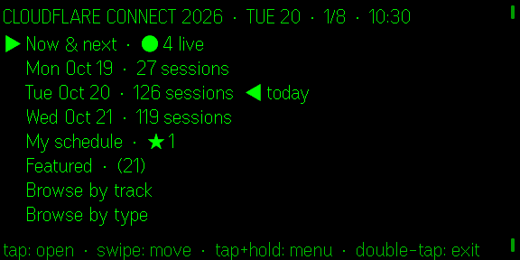

# Connect 2026 · Even Realities G2

A Cloudflare Connect 2026 (Moscone West, Oct 19–21) schedule app for Even Realities
G2 smart glasses, built on the [Even Hub SDK](https://hub.evenrealities.com/docs).



| | |
|---|---|
|  |  |
|  |  |
|  |  |

Captured from the [Even Hub simulator](https://hub.evenrealities.com/docs) at a simulated
Tue Oct 20, 10:30 (`?now=2026-10-20T10:30`). All frames are in [`docs/screenshots`](docs/screenshots)
and are 576 × 288 PNGs, the format the developer portal accepts for store listing screenshots.

On the glasses:

- **Home** – Now & next (live count), each event day, My schedule, Featured, browse by track / type.
- **Schedule** – every session with day banners and a live `── now HH:MM ──` marker. Scrolling
  past the end of a day flows straight into the next one. `●` = happening now, `★` = in my schedule.
- **Session detail** – paginated description, speakers with up to two speaker photos, time until start.
  Tap toggles the session in *My schedule*.
- **Context menu** (tap + hold): Now & next · Star / unstar · Jump to now · Next day · Previous day · My schedule · Home.
- **Hide tracks** – toggle whole tracks out of every list (Now & next, days, Featured, counts). *Cloudflare
  University* and *Global Partner Summit* are hidden by default. My schedule and "Browse by track" always
  show everything. The same toggles are checkboxes in the phone UI; the choice persists like starred sessions.

On the phone (the Even App WebView): search, day tabs, track and type filters, star sessions,
"Show on glasses", a live mirror of what the glasses display, and on-screen gesture buttons.
Starred sessions persist in Even App storage (and localStorage).

## Gestures

| Gesture | Lists | Session detail |
|---|---|---|
| Swipe up / down | move cursor | previous / next page |
| Tap | open | add / remove from my schedule |
| Double-tap | back (exit dialog on Home) | back |
| Tap + hold | context menu | context menu |

## Develop

```bash
pnpm install
pnpm dev                 # http://localhost:5181
pnpm simulate            # evenhub-simulator against the dev server
```

Open a specific moment of the event in the simulator (or use the *Developer → Simulate event time*
control on the companion page):

```bash
evenhub-simulator "http://localhost:5181/?now=2026-10-20T10:30"
```

Headless testing: `pnpm simulate:headless` exposes `http://127.0.0.1:7777/api/*` (`POST /api/input`
with `{"action":"up|down|click|double_click|context_menu"}`, `GET /api/screenshot/glasses`).

## Data

`src/data/sessions.json` and `public/speakers/*.png` are generated from the public
[sessions page](https://www.cloudflare.com/connect/sessions/):

```bash
pnpm data             # re-fetch sessions + convert new speaker photos (112px greyscale)
pnpm data --no-photos
```

The catalogue is bundled (no network permission needed on the glasses). Re-run `pnpm data` and
re-pack before the event to pick up schedule changes.

## Ship

```bash
pnpm ehpk             # builds and writes connect-g2.ehpk (pnpm reserves "pack")
pnpm qr               # QR code to sideload the dev server onto real glasses
```

## Layout notes

576×288 canvas, one firmware font (27 px line height). Header / body (8 rows) / footer text
containers are updated in place with `textContainerUpgrade`; the only `rebuildPageContainer` is
the switch between the full-width layout and the detail layout with two 112×112 image containers.
`@evenrealities/pretext` provides firmware-accurate glyph widths for truncation and pagination.
